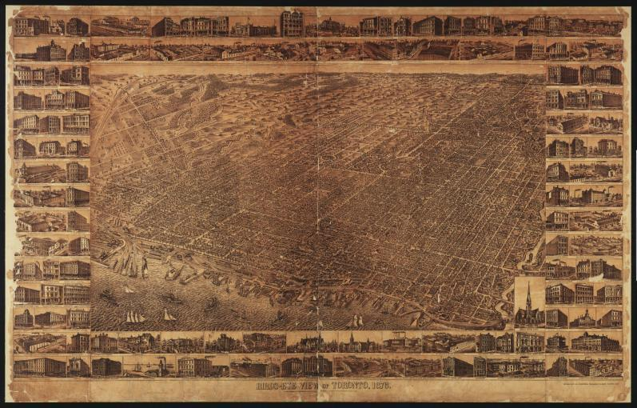
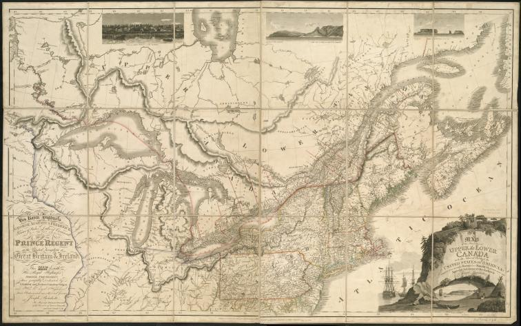
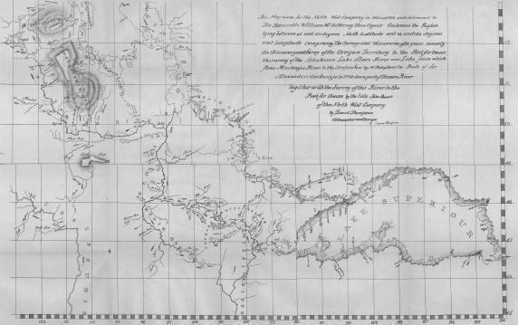
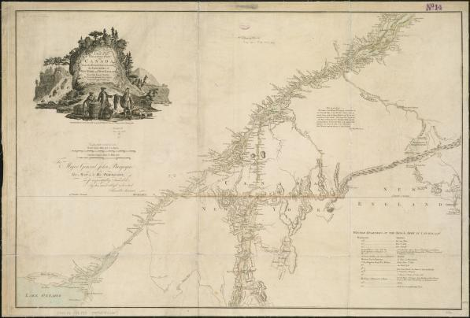
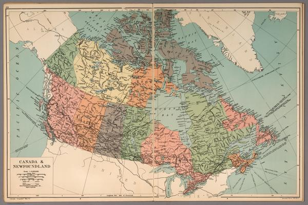
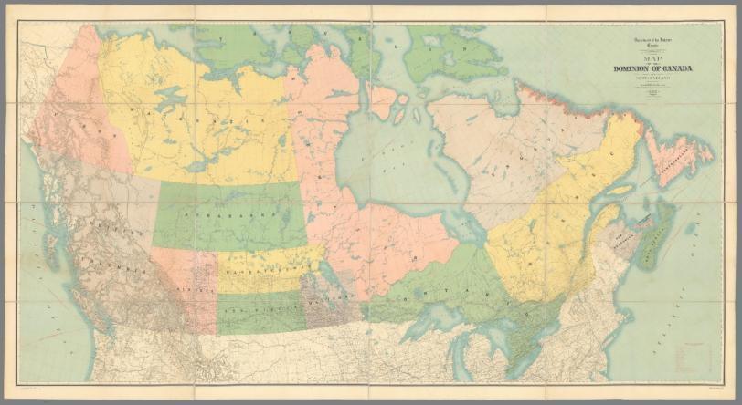
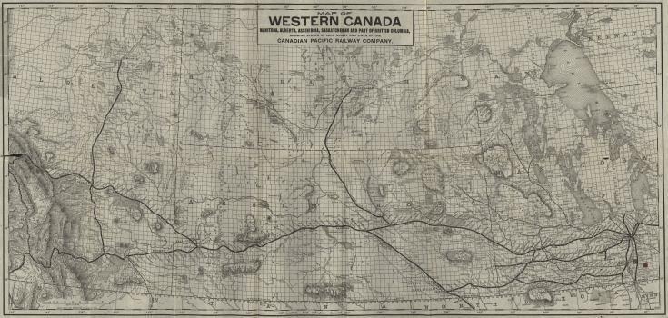

# Canadian Archival Maps (Gigapixel Tiles for StoryMapJS)

This repository hosts pre-sliced Zoomify tile pyramids for use with Knight Lab StoryMapJS.

## Instructions for StoryMapJS

In StoryMapJS, open **Options > StoryMap Type > Gigapixel**.  
Click the **copy button** on each box below to paste the values directly into the corresponding StoryMap options fields:
* **URL**
* **Max Width**
* **Max Height**
* **Attribution**

---

### 1. Toronto (1876)

[](https://commons.wikimedia.org/wiki/File:Toronto_1876.jpg)

* **Source:** [Wikimedia Commons (Public Domain)](https://commons.wikimedia.org/wiki/File:Toronto_1876.jpg)
* **URL:**
```text
https://courtneypattison.github.io/gigapixel/toronto1876/
```
* **Max Width:**
```text
12746
```
* **Max Height:**
```text
8150
```
* **Attribution:**
```html
<a href="https://commons.wikimedia.org/wiki/File:Toronto_1876.jpg">Art by P.A. Gross, lithographed by Copp, Clark &amp; Co. Limited.</a>, Public domain, via Wikimedia Commons. Tiled for Zoomify.
```

---

### 2. Upper & Lower Canada (1815)

[](https://www.digitalcommonwealth.org/search/commonwealth:8049g898c)

* **Source:** [Digital Commonwealth / Boston Public Library (Public Domain)](https://www.digitalcommonwealth.org/search/commonwealth:8049g898c)
* **URL:**
```text
https://courtneypattison.github.io/gigapixel/bouchette1815/
```
* **Max Width:**
```text
12096
```
* **Max Height:**
```text
7553
```
* **Attribution:**
```html
<a href="https://www.digitalcommonwealth.org/search/commonwealth:8049g898c">Joseph Bouchette, William Faden, J. Walker.</a>, Public domain, via Digital Commonwealth / Wikimedia Commons. Tiled for Zoomify.
```

---

### 3. Western British North America (1814)

[](https://commons.wikimedia.org/wiki/File:Map_of_Western_British_North_America_(David_Thompson_1813-1814).jpg)

* **Source:** [Manitoba Historical Maps / Wikimedia Commons (CC BY 2.0)](https://commons.wikimedia.org/wiki/File:Map_of_Western_British_North_America_(David_Thompson_1813-1814).jpg)
* **URL:**
```text
https://courtneypattison.github.io/gigapixel/thompson1814/
```
* **Max Width:**
```text
9146
```
* **Max Height:**
```text
5744
```
* **Attribution:**
```html
<a href="https://commons.wikimedia.org/wiki/File:Map_of_Western_British_North_America_(David_Thompson_1813-1814).jpg">David Thompson (1813-1814).</a>, licensed under <a href="https://creativecommons.org/licenses/by/2.0/">CC BY 2.0</a>, via Manitoba Historical Maps / Wikimedia Commons. Tiled for Zoomify.
```

---

### 4. Inhabited Part of Canada from French Surveys (1777)

[](https://collections.leventhalmap.org/search/commonwealth:x633f898c)

* **Source:** [Norman B. Leventhal Map Center / Boston Public Library (CC BY 2.0)](https://collections.leventhalmap.org/search/commonwealth:x633f898c)
* **URL:**
```text
https://courtneypattison.github.io/gigapixel/french1777/
```
* **Max Width:**
```text
9552
```
* **Max Height:**
```text
6464
```
* **Attribution:**
```html
<a href="https://collections.leventhalmap.org/search/commonwealth:x633f898c">William Faden (1777).</a>, licensed under <a href="https://creativecommons.org/licenses/by/2.0/">CC BY 2.0</a>, via Norman B. Leventhal Map &amp; Education Center at the Boston Public Library / Wikimedia Commons. Tiled for Zoomify.
```

---

### 5. Canada & Newfoundland (1935)

[](https://www.davidrumsey.com/luna/servlet/detail/RUMSEY~8~1~253284~5518819)

* **Source:** [David Rumsey Historical Map Collection (Public Domain / CC BY-NC-SA 3.0)](https://www.davidrumsey.com/luna/servlet/detail/RUMSEY~8~1~253284~5518819)
* **URL:**
```text
https://courtneypattison.github.io/gigapixel/gross1935/
```
* **Max Width:**
```text
9985
```
* **Max Height:**
```text
6656
```
* **Attribution:**
```html
<a href="https://www.davidrumsey.com/luna/servlet/detail/RUMSEY~8~1~253284~5518819">Alexander Gross, F.R.G.S., "Geographia" Map Co. (1935).</a>, Public domain / <a href="https://creativecommons.org/licenses/by-nc-sa/3.0/">CC BY-NC-SA 3.0</a>, via David Rumsey Historical Map Collection. Tiled for Zoomify.
```

---

### 6. Dominion of Canada and Newfoundland (1902)

[](https://www.davidrumsey.com/luna/servlet/detail/RUMSEY~8~1~358470~90125240)

* **Source:** [David Rumsey Historical Map Collection / Department of the Interior (Public Domain / CC BY-NC-SA 3.0)](https://www.davidrumsey.com/luna/servlet/detail/RUMSEY~8~1~358470~90125240)
* **URL:**
```text
https://courtneypattison.github.io/gigapixel/white1902/
```
* **Max Width:**
```text
32447
```
* **Max Height:**
```text
17747
```
* **Attribution:**
```html
<a href="https://www.davidrumsey.com/luna/servlet/detail/RUMSEY~8~1~358470~90125240">James White, F.R.G.S., Department of the Interior Canada, lithographed by The Toronto Lithographing Co. Limited (1902).</a>, Public domain / <a href="https://creativecommons.org/licenses/by-nc-sa/3.0/">CC BY-NC-SA 3.0</a>, via David Rumsey Historical Map Collection. Tiled for Zoomify.
```

---

### 7. Western Canada & Canadian Pacific Railway (1893)

[](https://www.flickr.com/photos/11496488@N07/3697307173)

* **Source:** [Historical Maps of Manitoba on Flickr / University of Manitoba Archives (CC BY 2.0)](https://www.flickr.com/photos/11496488@N07/3697307173)
* **URL:**
```text
https://courtneypattison.github.io/gigapixel/cpr1893/
```
* **Max Width:**
```text
11748
```
* **Max Height:**
```text
5599
```
* **Attribution:**
```html
<a href="https://www.flickr.com/photos/11496488@N07/3697307173">Canadian Pacific Railway Company / S.E. Dawson (1893).</a>, licensed under <a href="https://creativecommons.org/licenses/by/2.0/">CC BY 2.0</a>, via Historical Maps of Manitoba / Wikimedia Commons. Tiled for Zoomify.
```
